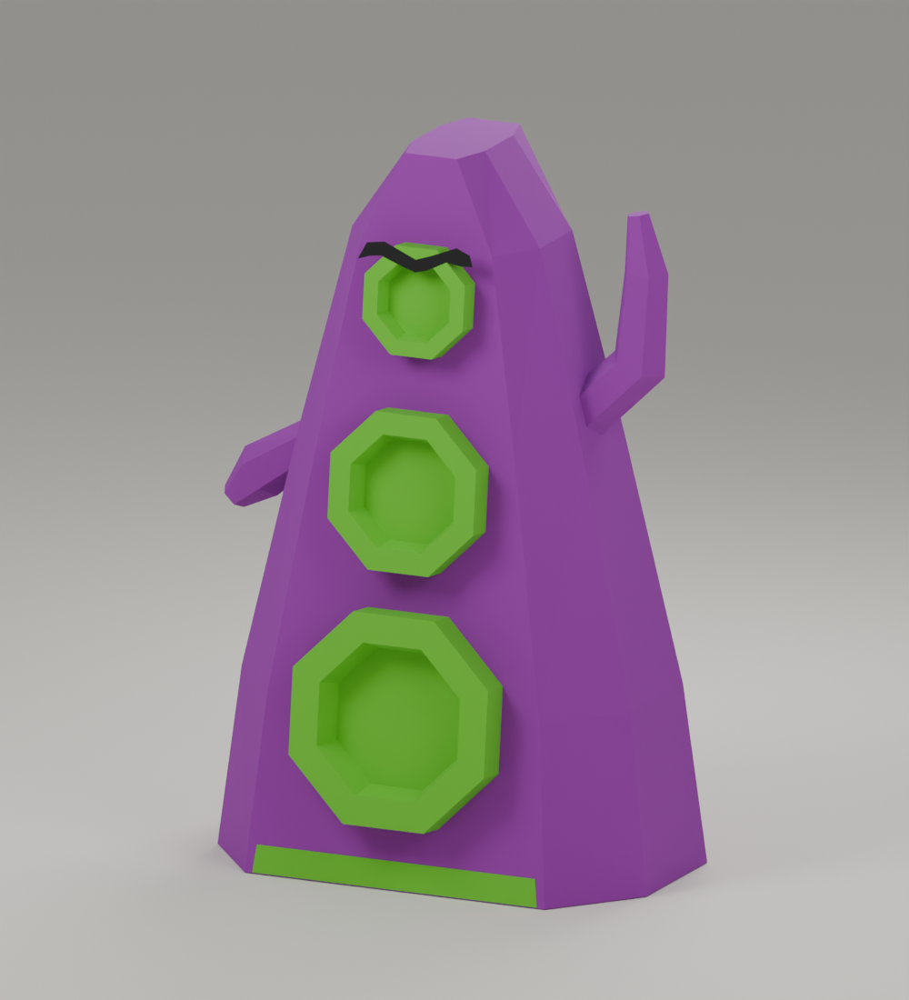

# Papercraft lab

Build a paper model from a real Blender mesh, unfold it with [PolyZamboni](https://github.com/AntonFlorey/PolyZamboni), and export coloured A4 patterns with numbered joints and glue tabs.

The first example is a 20 cm Purple Tentacle from *Day of the Tentacle*. Its concept was generated with AI, then approved before modelling. The mesh was built in Python with flat faces and separate parts that have flat gluing surfaces.



[Download the colour PDF](examples/tentacle/tentacule-B-20cm-papercraft-A4.pdf) · [Open the Blender model](examples/tentacle/tentacule-B-20cm.blend) · [Download the complete kit](https://github.com/sderosiaux/papercraft-lab/releases/latest)

The example has 38 structural pieces and two flat decorations. The PDF contains 13 pages, including a French assembly guide. Print in colour on white paper, single-sided, at 100%. Check the 50 mm scale bar before cutting. The coloured side faces outward; the edge numbers sit on tabs or in the waste paper. Copy the margin numbers onto the back before cutting them off.

## Run it

Tested on macOS Apple Silicon with Python 3.13, `bpy` 5.2.2 and PolyZamboni 1.3.1. Python dependencies and the PolyZamboni commit are pinned. The command-line scripts use Blender's `bpy` Python package; the desktop Blender app is useful for inspecting and editing the model.

Install [uv](https://docs.astral.sh/uv/getting-started/installation/) and Git, then:

```sh
git clone --recurse-submodules https://github.com/sderosiaux/papercraft-lab.git
cd papercraft-lab
make setup
make check
make smoke
make tentacle
```

`make smoke` builds a 30 mm cube and an 80 mm faceted pebble, unfolds them, and checks the results. `make tentacle` rebuilds the example, renders it, exports the colour patterns and packages a PDF and ZIP under `output/tentacule-B-20cm/`.

To regenerate the colour PDF from the included Blender model without remodelling or rendering:

```sh
make recolor
```

The GPU shader initialization used by PolyZamboni needs a working graphics context. A desktop macOS session was tested; a display-free Linux server was not. The artifact checks run without Blender. The scripts use local Blender preferences under `.blender-test-*` so they do not change the desktop application's preferences.

To inspect the unfolding in the desktop app, install PolyZamboni from Blender's Extensions preferences, open the example, select a part and open the PolyZamboni sidebar. Recompute the pattern after editing the mesh.

## Reuse the code

| File | Purpose |
| --- | --- |
| [`papercraft/pipeline.py`](papercraft/pipeline.py) | Audit meshes, unfold with glue tabs, check lengths and overlaps, arrange pages |
| [`papercraft/printing.py`](papercraft/printing.py) | Export solid material colours as vectors, place numbers outside coloured faces |
| [`build_tentacle.py`](build_tentacle.py) | Example geometry, attachment planes, closing pieces, Blender scene and renders |
| [`export_color.py`](export_color.py) | Apply the colour exporter to the saved Tentacle model |
| [`package_tentacle.py`](package_tentacle.py) | Assemble the French instructions, placement guide, patterns and ZIP |
| [`test_pipeline.py`](test_pipeline.py) | Integration checks, including invalid meshes that must be rejected |
| [`scripts/check_example.py`](scripts/check_example.py) | Check the committed PDF, colours, models and validation reports without Blender |

All mesh coordinates are in centimetres. `unwrap_and_audit()` accepts a Blender object, a maximum number of faces per piece, a tab height and optional faces to cut out as closing pieces. `export_and_audit()` arranges the components on paper and stores their page transforms in the mesh. Save that mesh in a `.blend` file before using `export_colored_parts()`.

See [the workflow guide](docs/workflow.md) for a new-model example, the concept approval step, print orientation and assembly checks. The colour exporter currently supports A4 pages and one solid material per component. Arbitrary textures and automatic image-to-3D conversion are not implemented.

## What is checked

The geometry checks cover closed, consistently oriented meshes, planar faces, complete face coverage, matching 3D/2D edge lengths, paired joint numbers, tab overlaps and page margins. A separate Shapely check compares the unfolded polygons. The colour exporter checks that every joint has both labels and that labels avoid coloured faces and each other.

For the included Tentacle, the maximum edge-length discrepancy is about 0.0000021 mm. The overlap tolerance is 0.0001 mm² per polygon pair. These are numerical checks: nobody has physically assembled this example yet. Paper thickness, access for gluing and collisions while folding still need a paper prototype.

GitHub Actions checks the committed example and Python syntax. It does not run Blender or claim to simulate folding.

## Tools and credits

The unfolding engine is [PolyZamboni](https://extensions.blender.org/add-ons/polyzamboni/), pinned as a Git submodule. The scripts call Blender directly through Python. A Blender MCP server can provide an interactive way to run those operations, but is not required here.

The code is licensed under [GPL-3.0-or-later](LICENSE). The Tentacle is an unofficial fan-made example; the underlying character and game belong to their respective rights holders. See [NOTICE](NOTICE) for attribution and asset scope.
